# Database ERD

Reflects the migrations in `database/migrations` as of Phases 0–2. All domain primary keys are ULIDs (`char(26)`); timestamps are UTC. Money is stored in integer paise (`*_paise`).

```mermaid
erDiagram
    users ||--o{ role_user : has
    roles ||--o{ role_user : grants
    roles ||--o{ permission_role : has
    permissions ||--o{ permission_role : in

    areas ||--o{ businesses : "primary_area_id"
    areas ||--o{ business_area : ""
    businesses ||--o{ business_area : ""
    categories ||--o{ categories : "parent_id"
    categories ||--o{ business_category : ""
    businesses ||--o{ business_category : ""
    businesses ||--o{ business_services : ""
    businesses ||--o{ business_hours : ""
    businesses ||--o{ business_hour_exceptions : ""
    businesses ||--o{ business_photos : ""
    media ||--o{ business_photos : ""
    businesses ||--o{ business_social_links : ""
    businesses ||--o{ offers : ""
    businesses ||--o{ business_claims : ""
    users ||--o{ business_claims : "claimant / reviewer"
    users ||--o{ businesses : "owner_id"

    places ||--o{ place_category : ""
    categories ||--o{ place_category : ""
    places ||--o{ place_area : ""
    areas ||--o{ place_area : ""
    places ||--o{ place_photos : ""
    places ||--o{ place_facilities : ""

    venues }o--|| areas : "area_id"
    venues }o--o| businesses : "business_id"
    venues }o--o| places : "place_id"
    organizers ||--o{ organizer_business : ""
    businesses ||--o{ organizer_business : ""
    events }o--o| venues : ""
    events }o--o| organizers : ""
    events }o--o| areas : ""
    events ||--o{ event_categories : ""
    categories ||--o{ event_categories : ""

    stories }o--o| users : "author_id"
    stories ||--o{ story_category : ""
    stories ||--o{ story_entities : "entity_type/entity_id"
    collections ||--o{ collection_items : "item_type/item_id"

    users ||--o{ reviews : ""
    reviews ||--o{ review_votes : ""
    users ||--o{ favorites : ""
    users ||--o{ submissions : ""
    users ||--o{ reports : ""
    users ||--o{ audit_logs : "actor_id"
    users ||--o{ analytics_events : ""
```

## Polymorphic columns

Allowed `*_type` values come from `App\Enums\EntityType` (enforced morph map):
`business, place, event, story, collection, area, category, venue, organizer, review, user`.

| Table | Morph | Allowed types (validated at API boundary) |
|---|---|---|
| reviews | reviewable | business, place, event |
| favorites | favoritable | business, place, event, story |
| collection_items | item | business, place, event, story |
| story_entities | entity | business, place, event, area |
| submissions | entity (nullable) | target entity for corrections/photos |
| reports | reportable | any public entity |
| audit_logs | auditable (nullable) | any |
| analytics_events | entity (nullable) | business, place, event, story, collection |

## Constraints and indexes

- Unique: every `slug`; `roles.name`; `permissions.name`; `categories.slug`; `(user_id, reviewable_type, reviewable_id)` on reviews; `(user_id, favoritable_type, favoritable_id)` on favorites; `(collection_id, item_type, item_id)`; `(story_id, entity_type, entity_id)`; `(business_id, platform)` on social links; `(business_id, date)` on hour exceptions; `(place_id, name)` on facilities.
- CHECK `reviews.rating BETWEEN 1 AND 5` (MySQL/PostgreSQL; SQLite relies on validation).
- Listing indexes: `businesses(is_published, status|created_at|rating_avg)`, `places(status, published_at)`, `events(status, starts_at)`, `events(area_id, starts_at)`, `stories(status, published_at)`, `stories(type, status)`, `collections(status, published_at)`, `categories(type, is_active, sort_order)`, pivot reverse indexes on every `*_id`.
- Soft deletes: users, areas, categories, businesses, offers, places, venues, organizers, events, stories, collections, reviews.

## Status columns

| Table | Values |
|---|---|
| businesses.status | UNVERIFIED, SUBMITTED, UNDER_REVIEW, VERIFIED, CLAIMED, SUSPENDED, CLOSED |
| events.status | DRAFT, SUBMITTED, REVIEW, PUBLISHED, CANCELLED, ARCHIVED (phase derived) |
| places/stories/collections.status | DRAFT, REVIEW, PUBLISHED, ARCHIVED |
| reviews.status | PENDING, PUBLISHED, REJECTED, HIDDEN |
| business_claims.status | PENDING, APPROVED, REJECTED, CANCELLED |
| submissions.status | PENDING, NEEDS_INFO, APPROVED, REJECTED |
| reports.status | OPEN, RESOLVED, DISMISSED |
| *_photos.status | PENDING, APPROVED, REJECTED |

## Not yet created (by design)

Monetization (`plans`, `features`, `plan_features`, `subscriptions`, `subscription_items`, `payments`, `advertisements`) — Phase 8. `notifications` — Phase 11. All `ai_*` tables — Phase 14 (designed in [ai-data-engine.md](ai-data-engine.md)). `locations` — see architecture decision D6.
